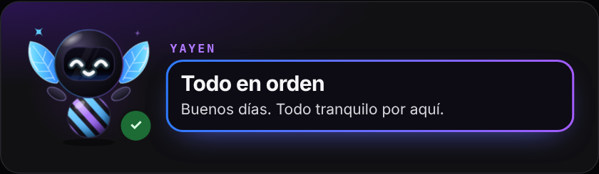
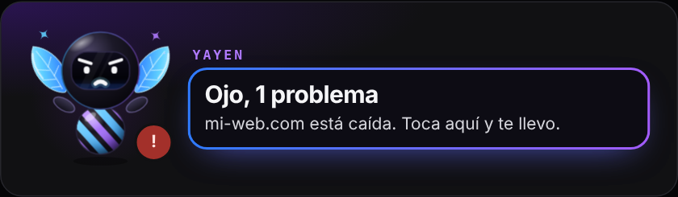
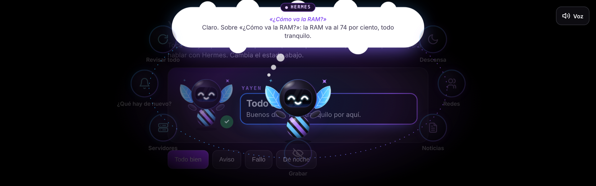
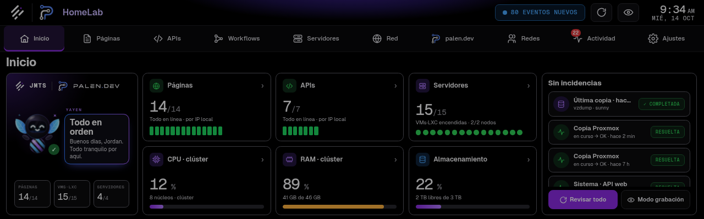
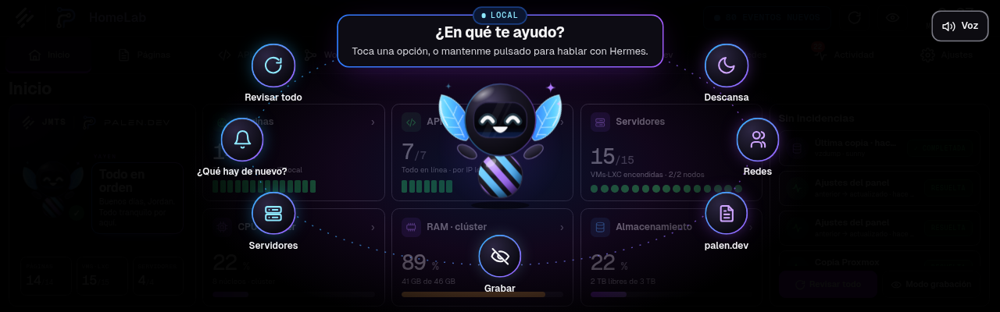
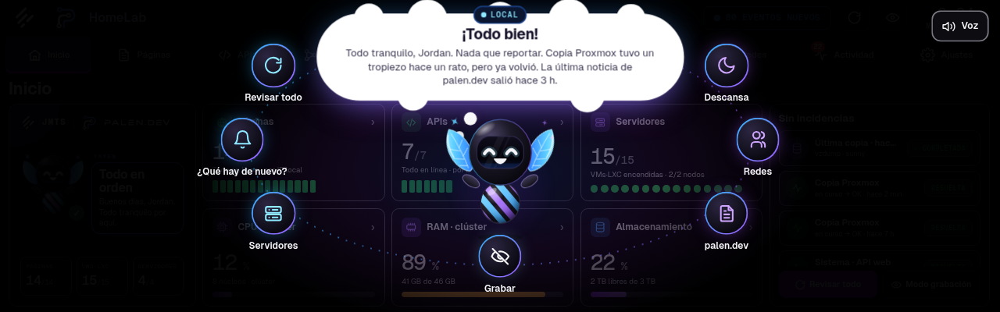

# Yayen

**Yayen** es una mascota-asistente para paneles, dashboards y pantallas táctiles: un personajito con dos hojas, visor y
cuerpo de rayas que te dice cómo va todo, responde en una nube de pensamiento, habla con su propia voz y, si lo mantienes
pulsado, le pasa tu pregunta a **Hermes** (tu agente de IA).

Nació en el panel del rack de [palen.dev](https://palen.dev) / JMTS y aquí está separado para que cualquiera lo ponga
donde quiera. **Sin dependencias ni build**: un `.js`, un `.css` y, si quieres voz y Hermes, un servidor de Python
con la biblioteca estándar.

<p align="center"> </p>

| Toque: opciones y respuesta en la nube | Mantener pulsado: Hermes |
|---|---|
|  |  |

## Qué hace

- **Cara según el estado**: contento (todo bien), serio (aviso), preocupado con gota de sudor (fallo), dormido (noche),
  con gafas (modo grabación), escuchando, pensando. La insignia verde/ámbar/roja dice el estado; los colores del
  personaje son solo decoración.
- **Un toque**: se abren hasta 7 opciones en órbita. Tu app responde (con tus datos) y Yayen lo muestra en una **nube
  blanca de pensamiento** y lo dice en voz alta. **Otro toque cierra.** Si la respuesta apunta a una sección, tocar la
  nube te lleva allí.
- **Mantener pulsado**: modo **Hermes**. Escribes (y más adelante hablas) y Yayen le pregunta a Hermes a través de tu
  servidor; el token de Hermes nunca llega al navegador.
- **Voz propia «Digital»**: Piper local (sin Internet) con un ajuste de tono, coro y eco. Si no está instalada, usa la
  voz del navegador.
- **Modo ligero** automático en equipos modestos (p. ej. un thin client como pantalla): sin animaciones continuas.
- Cabe en pantallas apaisadas muy bajas (diseñado para 1280×400) y en vertical.

## Yayen vivo: gestos, acciones y efectos

<p align="center"></p>

`src/yayen-vivo.js` le da **vida propia**: respira, parpadea, mira alrededor, sigue tu dedo y cambia según lo que pasa.
Tiene acabado realista (cristal negro con luz de borde, hojas de vidrio que brillan, ojos luminosos, aro holográfico)
y lleva el **logo de palen.dev** en el cuerpo (`logo: false` lo quita).

- **24 gestos**: contento, risa (con «ja ja ja»), majestuoso, escéptico («hmm…»), enfadado (echa humito), furioso,
  sorpresa, idea (bombilla), enamorado, triste, mareado, dormido (zzz)…
- **14 acciones con objetos**: trabajando en su laptop, leyendo un libro, **compilando función por función** (cada
  una gira y se vuelve ✓), analizando, buscando con lupa, desplegando un cohete, descargando, música, grabando…
- **17 efectos** y **secuencias**: al **despertarlo** abre un ojo, bosteza, se estira, sacude la cabeza y salta contento.
- Se amplía sin tocar el código: `YayenVivo.registrarGesto`, `registrarEfecto` y `registrarAccion`.

```js
const yy = YayenVivo.crear(document.getElementById('yayen'));
yy.despertar().then(() => yy.accion('compilando', { items: ['server.py', 'yayen.js'] }));
```

Catálogo completo, API y cómo añadir gestos: **[docs/CATALOGO.md](docs/CATALOGO.md)** · demo: `demo/vivo.html`.


## Yayen para imprimir

En [`assets/`](assets/) está Yayen en **SVG vectorial** (el principal y 28 poses) y en PNG transparente, listo para
mousepads, stickers, camisetas o redes. Notas de impresión y colores: [assets/README.md](assets/README.md).

<p align="center"></p>

## Empezar en 1 minuto

```sh
git clone https://github.com/palendev/yayen && cd yayen
python3 server/yayen_server.py      # abre http://127.0.0.1:8787
```

Sin nada más ya ves la demo (voz del navegador, sin Hermes). Para su voz y Hermes:

```sh
sudo sh tools/instalar-voz.sh        # Piper + voz + ffmpeg (una vez, ~70 MB)
cp server/.env.example server/.env   # y rellena HERMES_URL / HERMES_TOKEN
chmod 600 server/.env
python3 server/yayen_server.py
```

## Ponerlo en tu app

```html
<link rel="stylesheet" href="yayen.css">
<div id="yayen"></div>
<script src="yayen.js"></script>
<script>
  const yy = Yayen.mount(document.getElementById('yayen'), {
    status: () => ({ level: 'ok', title: 'Todo en orden', text: ['Todo tranquilo por aquí.', 'Las 14 páginas están arriba.'] }),
    options: [{ id: 'news', label: '¿Qué hay de nuevo?', icon: 'bell' }],
    answer: async id => ({ title: '¡Todo bien!', text: 'Todo está bien. Todo en orden.', face: 'happy' }),
    voice:  { url: '/api/yayen/voz',    headers: { 'X-Yayen': '1' } },
    hermes: { url: '/api/yayen/hermes', headers: { 'X-Yayen': '1' } },
  });
  // cuando cambien tus datos:
  yy.update();
</script>
```

Todo el detalle (opciones, caras, navegación, estilos, tamaños): **[docs/INTEGRAR.md](docs/INTEGRAR.md)**.

## En el panel real

Así se ve en la pantalla táctil del rack (1280×400), integrado en el Inicio del panel del homelab:

| Inicio | Opciones | Respuesta |
|---|---|---|
|  |  |  |

## Guías

| | |
|---|---|
| [docs/INTEGRAR.md](docs/INTEGRAR.md) | API de `Yayen.mount`, dónde colocarlo, estados, opciones, estilos |
| [docs/VOZ.md](docs/VOZ.md) | Voz «Digital» con Piper local: instalación, ajuste, dónde suena |
| [docs/HERMES.md](docs/HERMES.md) | Darle acceso a Hermes: credenciales, `.env`, seguridad y un ejemplo real |
| [docs/PERSONAJE.md](docs/PERSONAJE.md) | El personaje: partes, caras, animaciones y cómo personalizarlo |
| [docs/CATALOGO.md](docs/CATALOGO.md) | Yayen vivo: todos los gestos, acciones, efectos y secuencias, y cómo añadir más |
| [assets/README.md](assets/README.md) | Archivos para imprimir (SVG y PNG), colores y consejos de imprenta |

## Estructura

```
src/yayen.js            el personaje, la tarjeta, la capa de opciones, la nube, la voz y los gestos
src/yayen.css           estilos (variables --yy-* para adaptarlo a tu marca)
src/yayen-vivo.js       Yayen vivo: gestos, acciones con objetos, efectos y secuencias (sin dependencias)
demo/index.html         demo con datos de ejemplo
demo/vivo.html          catálogo interactivo de Yayen vivo
assets/                 Yayen en SVG y PNG para imprimir y para marca
server/yayen_server.py  servidor de ejemplo: demo + /api/yayen/voz (Piper) + /api/yayen/hermes (puente)
server/.env.example     dónde van las credenciales (copiar a server/.env)
tools/instalar-voz.sh   instala Piper, la voz y ffmpeg
```

## Licencia

Código bajo [MIT](LICENSE). El diseño del personaje Yayen es de Jordan Palen (palen.dev); puedes usarlo en tus
proyectos con el código.
