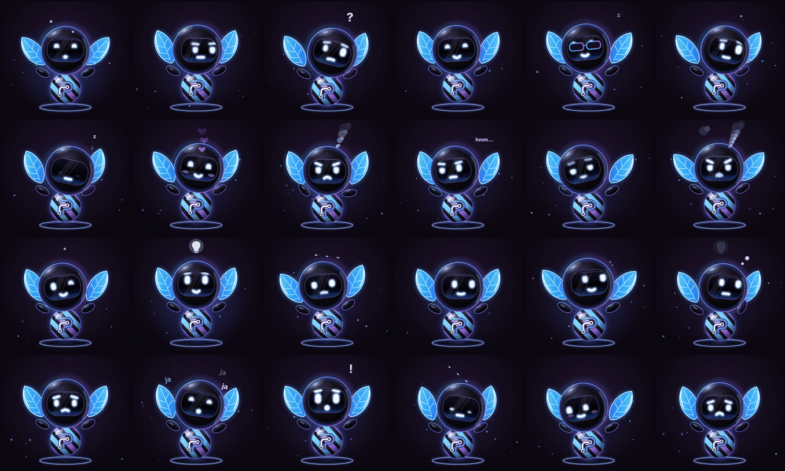
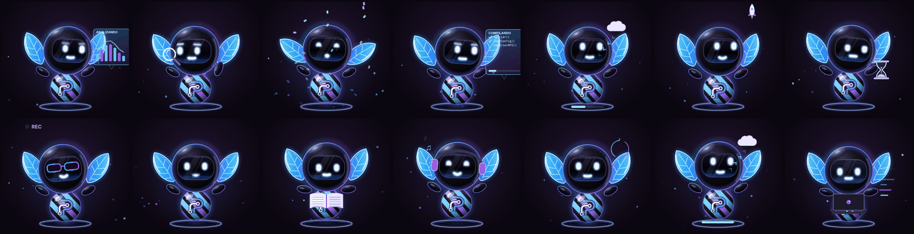

# Catálogo de Yayen vivo

`src/yayen-vivo.js` es Yayen con vida propia: respira, parpadea, mira alrededor, sigue tu dedo o el ratón, y cambia
de cara, de postura y de objeto según lo que esté pasando. No tiene dependencias ni build, y funciona en cualquier página.

Pruébalo en `demo/vivo.html`, que tiene un botón por cada gesto, acción, efecto, secuencia y estado:
`python3 server/yayen_server.py` → <http://127.0.0.1:8787/demo/vivo.html>.

<p align="center"></p>

```html
<div id="yayen" style="width:420px;height:400px"></div>
<script src="yayen-vivo.js"></script>
<script>
  const yy = YayenVivo.crear(document.getElementById('yayen'));
  yy.gesto('risa');                                        // cara + «ja ja ja»
  yy.accion('compilando', { items: ['server.py', 'yayen.js', 'app.css'] });
  yy.despertar().then(() => yy.saludar());                 // las secuencias devuelven una promesa
</script>
```

## Cómo está hecho

- **Esqueleto de cara.** Cada gesto es una lista de números: giro de cabeza (`yaw`, `pitch`, `roll`), mirada (`gx`,
  `gy`), párpados (`lidL`, `lidR`), ojos sonrientes (`hapL`, `hapR`), tamaño de cada ojo (`sxL`, `syL`, `sxR`, `syR`),
  cejas (`brow`, `bA`), boca (`smile`, `open`), alas (`flap`, `wing`), brazos (`armL`, `armR`), gafas (`glasses`), aura
  (`glow`), rubor (`tint`) y tamaño (`scale`).
- **Muelles.** Yayen no salta de un gesto a otro: cada número se mueve con un muelle con un poquito de rebote. Así
  cualquier par de gestos se mezcla bien, incluidos los que añadas tú.
- **Falso 3D.** Al girar la cabeza, el visor se desplaza y se estrecha, el ojo cercano crece y el brillo se mueve al
  lado contrario.
- **Vida propia** (`vida: true`). Respira, parpadea a ratos (a veces dos veces seguidas), mira a los lados cuando está
  tranquilo y balancea las hojas. Con `majestuoso: true` todo va más lento y amplio, con un aura que late.
- **Acabado realista.** Cabeza de cristal negro con luz de borde azul y morada, hojas de vidrio que brillan, ojos y
  boca luminosos, el logo de palen.dev en el cuerpo, un aro holográfico en el suelo y motas de luz flotando alrededor.
- **Modo ligero** (`ligero: 'auto'`). En equipos con 2 núcleos o 2 GB o menos (como un thin client) quita los
  desenfoques y las motas, baja la cantidad de partículas y deja el aura quieta.
- **Toque.** Un toque lo hace saltar contento; si está dormido, lo despierta. Si lo mantienes pulsado, se queda
  escuchando.

Técnica inspirada en *bible-strong-avatar-lab* (cara con parámetros y muelles). El código de Yayen está escrito desde
cero; no copia nada de ese proyecto, que tiene otra licencia (AGPL).

## Opciones de `crear(contenedor, opciones)`

| Opción | Por defecto | Qué hace |
|---|---|---|
| `vida` | `true` | Respirar, parpadear y mirar alrededor por su cuenta |
| `seguir` | `true` | Los ojos siguen el puntero o el dedo |
| `majestuoso` | `true` | Movimiento más lento y amplio, con aura y respiración |
| `ligero` | `'auto'` | `true` o `false` para forzar el modo ligero |
| `interactivo` | `true` | Responde al toque (saltar o despertar) y a mantener pulsado (escuchar) |
| `logo` | `true` | El logo de palen.dev en el centro del cuerpo. `false` lo quita |

## API

| Llamada | Qué hace |
|---|---|
| `gesto(id)` | Cambia la cara y lanza sus efectos |
| `accion(id, opciones)` | Saca un objeto y una postura (computadora, libro, panel…). `accion(null)` lo guarda |
| `efecto(id, ms)` | Lanza un efecto suelto durante `ms` (1600 por defecto) |
| `despertar()` / `dormir()` / `saludar()` / `enfadarse()` | Secuencias; devuelven una promesa |
| `saltar(fuerza)` | Saltito |
| `hablar(true/false)` | Mueve la boca mientras suena la voz |
| `mirar(x, y)` | Mira hacia un punto (−1…1) |
| `estado` | `{ gesto, accion }` actuales |
| `svg()` | El `<svg>` vivo (para exportar o capturar) |
| `destruir()` | Para la animación y limpia el contenedor |

`YayenVivo.catalogo()` devuelve la lista completa, así que una app puede pintar sus propios botones (como hace
`demo/vivo.html`).

## Gestos



| id | Nombre | Efectos que lanza |
|---|---|---|
| `neutral` | Neutral | — |
| `contento` | Contento | — |
| `alegre` | Alegre | `chispas` |
| `risa` | Risa | `jaja` |
| `orgulloso` | Majestuoso | `brillo` |
| `curioso` | Curioso | — |
| `esceptico` | Escéptico | `hmm` |
| `confundido` | Confundido | `pregunta` |
| `sorpresa` | Sorpresa | `exclamacion` |
| `idea` | Idea | `bombilla` |
| `piensa` | Pensando | `puntos` |
| `escucha` | Escuchando | — |
| `concentrado` | Concentrado | — |
| `guino` | Guiño | `chispas` |
| `timido` | Tímido | — |
| `enamorado` | Enamorado | `corazones` |
| `preocupado` | Preocupado | `sudor` |
| `triste` | Triste | `lagrima` |
| `enfadado` | Enfadado | `humo` |
| `furioso` | Furioso | `humo-fuerte` |
| `mareado` | Mareado | `espiral` |
| `sueno` | Con sueño | — |
| `dormido` | Dormido | `zzz` |
| `cool` | Con gafas | — |

## Acciones (con objetos)

Cada acción es una postura más un objeto animado. Se combinan con un gesto: `yy.gesto('preocupado'); yy.accion('compilando')`.



| id | Qué se ve |
|---|---|
| `trabajando` | Trabajando (computadora) |
| `leyendo` | Leyendo (libro) |
| `compilando` | Compilando (función por función) |
| `analizando` | Analizando (gráfica) |
| `buscando` | Buscando (lupa) |
| `descargando` | Descargando |
| `subiendo` | Subiendo |
| `desplegando` | Desplegando (cohete) |
| `esperando` | Esperando (reloj de arena) |
| `sincronizando` | Sincronizando |
| `musica` | Escuchando música |
| `grabando` | Grabando |
| `celebrando` | Celebrando |
| `hablando` | Hablando |

Detalles:

- **trabajando**: una laptop con su tapa y logo, las teclas se encienden al teclear, los brazos se mueven y salen
  líneas de código al lado. La pantalla ilumina el visor.
- **leyendo**: un libro abierto, los ojos recorren las líneas y pasa la página.
- **compilando**: un panel holográfico «COMPILANDO» lista las funciones una a una. Cada una tiene su animación: gira
  mientras compila y se vuelve ✓ al terminar, con una barra de progreso total. Pasa tus nombres reales con
  `yy.accion('compilando', { items: ['iniciar()', 'leerConfig()'] })`.
- **buscando**: la lupa recorre la pantalla y los ojos la siguen.
- **desplegando**: un cohete despega y Yayen lo sigue con la mirada.

## Efectos

Se lanzan solos con cada gesto o sueltos con `yy.efecto(id, ms)`.

| id | Nombre |
|---|---|
| `humo` | Humo |
| `humo-fuerte` | Humo fuerte |
| `jaja` | «Ja ja ja» |
| `chispas` | Chispas |
| `brillo` | Brillo majestuoso |
| `corazones` | Corazones |
| `sudor` | Sudor |
| `lagrima` | Lágrima |
| `pregunta` | Interrogación |
| `exclamacion` | Exclamación |
| `hmm` | «Hmm…» |
| `puntos` | Puntos de pensar |
| `bombilla` | Bombilla |
| `espiral` | Mareo |
| `zzz` | Zzz |
| `confeti` | Confeti |
| `notas` | Notas musicales |

## Secuencias

| Secuencia | Qué hace |
|---|---|
| `despertar` | Abre un ojo, parpadea, bosteza estirando hojas y brazos, sacude la cabeza, mira a los lados, salta alegre y queda contento |
| `dormir` | Le entra sueño, bosteza, se le cierran los ojos y se duerme (salen «z») |
| `saludar` | Salta alegre y saluda con la mano |
| `enfadarse` | Concentrado, luego enfadado (humo) y al final furioso |

## Estados sugeridos

`YayenVivo.catalogo().estados` sugiere qué hacer con cada estado de una app. Cada app decide; esto es solo un punto de partida.

| Estado | Yayen |
|---|---|
| `ok` | gesto `contento` |
| `aviso` | gesto `preocupado` |
| `error` | gesto `enfadado` |
| `caido` | gesto `furioso` |
| `noche` | gesto `dormido` |
| `revisando` | acción `buscando` |
| `desplegando` | acción `desplegando` |
| `compilando` | acción `compilando` |
| `descargando` | acción `descargando` |
| `subiendo` | acción `subiendo` |
| `sincronizando` | acción `sincronizando` |
| `analizando` | acción `analizando` |
| `trabajando` | acción `trabajando` |
| `leyendo` | acción `leyendo` |
| `esperando` | acción `esperando` |
| `grabando` | acción `grabando` |
| `hablando` | acción `hablando` |
| `celebrando` | acción `celebrando` |
| `pensando` | gesto `piensa` |
| `escuchando` | gesto `escucha` |

Ejemplo para un panel:

```js
const E = YayenVivo.catalogo().estados;
function alCambiar(estado) {
  const e = E[estado] || { gesto: 'neutral' };
  yy.accion(e.accion || null);
  if (e.gesto) yy.gesto(e.gesto);
}
```

## Ampliar el catálogo

No hace falta tocar `yayen-vivo.js`: registra lo nuevo antes de usarlo.

```js
// Un gesto: solo números (los que no pongas quedan en neutro) + efectos opcionales
YayenVivo.registrarGesto('orgullosoDeTi', { nombre: 'Orgulloso de ti', hapL: 1, hapR: 1, smile: 1, wing: .4, glow: .9, fx: ['brillo', 'corazones'] });

// Un efecto: cada cuánto sale una partícula, cómo se crea y cómo se mueve (k va de 0 a 1 en su vida)
YayenVivo.registrarEfecto('estrellas', {
  nombre: 'Estrellas', cada: 400,
  crear(c) {
    const t = document.createElementNS('http://www.w3.org/2000/svg', 'text');
    t.textContent = '★'; t.setAttribute('fill', '#ffd36b'); c.fx.appendChild(t);
    const x = 40 + Math.random() * 120;
    return { el: t, vida: 1500, mover(el, k) { el.setAttribute('x', x); el.setAttribute('y', 40 - k * 60); el.setAttribute('opacity', 1 - k); } };
  },
});

// Una acción: postura + objetos en c.props; devuelve una función que se llama en cada fotograma
YayenVivo.registrarAccion('regando', {
  nombre: 'Regando las plantas', pose: { pitch: .3, gy: .6, armR: 30 },
  montar(c, opciones) {
    const g = document.createElementNS('http://www.w3.org/2000/svg', 'g'); c.props.appendChild(g);
    // … dibuja la regadera en g …
    return t => g.setAttribute('transform', `translate(150 120) rotate(${Math.sin(t / 300) * 10})`);
  },
});
```

Dentro de `montar` y `crear` tienes `c`:

| Campo | Qué es |
|---|---|
| `c.props`, `c.fx`, `c.back` | Capas del SVG: objetos, partículas delante y partículas detrás |
| `c.P` | Valores actuales del esqueleto (por ejemplo `c.P.yaw` para seguir el giro de la cabeza) |
| `c.lookAt = { x, y }` | Hace que los ojos miren a un punto (−1…1) |
| `c.screen` | Brillo de pantalla sobre el visor (0…1) |
| `c.typing`, `c.groove`, `c.scan`, `c.talk` | Brazos tecleando, balanceo al ritmo, ojos leyendo, boca hablando |
| `c.efecto(id, ms)`, `c.bucle(id)` | Lanzar un efecto puntual o mantenerlo mientras dure la acción |

Coordenadas: el personaje vive en un lienzo de 200 × 200 (cabeza centrada en 100, 66; cuerpo en 100, 148). El
`viewBox` deja margen alrededor para efectos y objetos.

Si añades algo que valga para todos, súmalo a `GESTOS`, `EFECTOS` o `ACCIONES` en `src/yayen-vivo.js` y a este catálogo.
